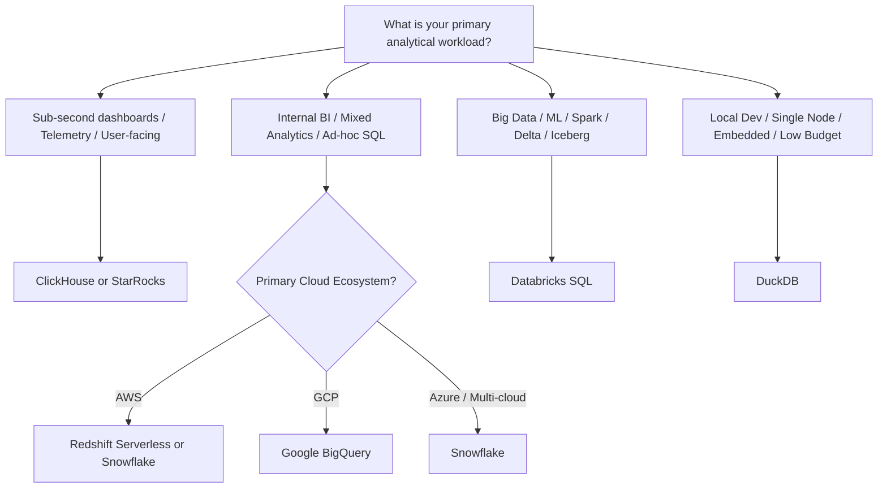

# Deep-Dive Data Warehouse Comparison

This document provides a comprehensive, production-grade technical evaluation of the top analytical data engines:
1. **Snowflake**
2. **Google Cloud BigQuery**
3. **AWS Redshift Serverless**
4. **Databricks SQL (Lakehouse)**
5. **ClickHouse**
6. **DuckDB** (Reference in-process baseline)

---

## 1. Architectural Taxonomy

| Feature | Snowflake | Google BigQuery | AWS Redshift Serverless | Databricks SQL | ClickHouse | DuckDB |
| :--- | :--- | :--- | :--- | :--- | :--- | :--- |
| **Storage Architecture** | Proprietary micro-partitioned columnar format on Cloud Object Storage (S3/GCS/Azure Blob); supports Apache Iceberg | Capacitor columnar format on Colossus (Google distributed file system); supports BigLake/Iceberg | Redshift Managed Storage (RMS) backed by Amazon S3 + local NVMe cache | Delta Lake (Parquet + transaction log) on Object Storage; supports UniForm (Iceberg/Hudi) | Columnar format with primary sort index on local NVMe or S3-backed Object Storage | Single-file columnar format on local disk or in-memory |
| **Compute Architecture** | Virtual Warehouses (isolated stateless EC2/GCE/Azure VM clusters) | Borg-managed dynamic Dremel compute slot pool | Auto-scaling Redshift Processing Units (RPUs) | Serverless or Classic SQL Warehouses powered by the C++ Photon engine | Native C++ SIMD-vectorized multi-threaded worker nodes | Single-process multi-threaded vectorized C++ engine |
| **Decoupled Storage & Compute?** | Yes (100% independent) | Yes (100% independent) | Yes (Compute decoupled from RMS storage) | Yes (Delta Lake storage + separate SQL compute) | Optional (Cloud version decouples storage; open-source can do both) | In-process (Local disk or S3 remote query via HTTP/S3 extension) |
| **Open Formats Support** | Apache Iceberg (External / Managed tables) | Iceberg, Delta, Parquet, ORC, Avro via BigLake | Apache Iceberg, Delta Lake, Hudi via external tables / Redshift Spectrum | Native Delta Lake, Iceberg, and Hudi via UniForm | Parquet, ORC, CSV, JSON, Arrow, Iceberg, Delta (via table engines) | Native Parquet, Arrow, CSV, JSON, Iceberg, Delta |

---

## 2. Dimension-by-Dimension Analysis

### A. Query Execution Speed & Latency Characteristics

```
Latency Spectrum:
[Sub-second / Real-time OLAP] ◄─────────────────────────────────────────────► [Massive Petabyte Batch Scan]
DuckDB / ClickHouse               Snowflake (Warm)        Databricks SQL / Redshift         BigQuery
```

#### 1. Interactive & Sub-Second Queries (Dashboards, BI, Embedded Analytics)
* **ClickHouse**: Unrivaled speed for single-table aggregations over millions/billions of rows. Uses SIMD vectorization, sparse primary indexes, and custom table engines (e.g., `AggregatingMergeTree`).
* **DuckDB**: Delivers microsecond-to-millisecond query execution on single machines. Zero network round-trip overhead.
* **Snowflake**: Warm queries benefit from two levels of caching: **Local Disk Cache** (SSD cache on the Virtual Warehouse) and **Result Cache** (persisted for 24 hours globally if underlying data has not changed). Cold queries experience a 1–4 second VM startup/wake penalty.
* **Google BigQuery**: Baseline query scheduling floor of ~1–2 seconds due to Dremel slot allocation and coordination. For true sub-second BI dashboards, BigQuery requires configuring **BigQuery BI Engine** (in-memory acceleration).
* **Databricks SQL**: Photon engine provides fast execution, but cold warehouse spin-up can take 10–45 seconds unless Serverless SQL is enabled.

#### 2. Complex Joins, Large-Scale ETL & Window Functions
* **Databricks SQL**: Industry leader for heavy transformations and multi-way joins, benefiting from Spark/Photon's cost-based optimizer, adaptive query execution (AQE), and runtime bloom filters.
* **BigQuery**: Seamlessly handles petabyte-scale shuffles and joins by dynamically allocating thousands of slots on-the-fly without running out of memory (`OOM`).
* **AWS Redshift Serverless**: Outstanding performance on star/snowflake schemas when distribution keys (`DISTKEY`) and sort keys (`SORTKEY`) are well-designed.

---

### B. Pricing Models & Cost Predictability

Understanding the pricing model is critical to avoid unexpected cloud spend:

```
┌────────────────────────────────────────────────────────────────────────┐
│                        PRICING MODEL COMPARISON                        │
├──────────────────┬─────────────────────────────────────────────────────┤
│ Per-TB Scanned   │ BigQuery On-Demand: $6.25 per TB processed          │
├──────────────────┼─────────────────────────────────────────────────────┤
│ Compute Time     │ Snowflake: Credits/second (XS = 1 credit/hr ~$2-$3) │
│ (Virtual Cluster)│ Redshift Serverless: Base RPU ($0.375/RPU-hour)     │
│                  │ Databricks: DBU/hr + underlying cloud VM costs      │
├──────────────────┼─────────────────────────────────────────────────────┤
│ Infrastructure   │ ClickHouse Self-hosted / DuckDB: $0 software cost   │
│ Only or Free     │ (pay only for your own hardware / cloud VM)         │
└──────────────────┴─────────────────────────────────────────────────────┘
```

#### 1. The Per-Query / On-Demand Trap (BigQuery)
* **Advantage**: $0 when no queries are running. Perfect for sporadic usage or batch pipelines that run once an hour/day.
* **Gotcha**: A junior analyst running `SELECT * FROM fact_transactions WHERE UPPER(user_agent) LIKE '%Mobile%'` on a 50 TB unpartitioned table will immediately cost **$312.50 for a single query**.
* **Mitigation**: Always enforce `maximum_bytes_billed` in query settings and require partition filters via `require_partition_filter = true`.

#### 2. The Per-Second Compute Trap (Snowflake & Redshift Serverless)
* **Advantage**: High cost predictability. You pay for the size of the cluster, not the amount of data scanned. 1 TB or 100 TB costs the exact same compute credits as long as it executes within the warehouse uptime.
* **Gotcha**: Leaving a 2X-Large warehouse running 24/7 unintentionally will burn 32 credits/hour × 24 × 30 = 23,040 credits (~$46,000–$69,000/month).
* **Mitigation**: Set `AUTO_SUSPEND = 60` (or 120 seconds) and set up Account Resource Monitors to automatically cut off compute when budgets are exceeded.

#### 3. Storage Pricing
* **BigQuery**: $0.020/GB/month active; automatically drops to **$0.010/GB/month (50% discount)** for physical storage unmodified for 90 days.
* **Snowflake**: $23 to $40 per TB/month depending on pre-purchased capacity vs on-demand.
* **AWS Redshift**: $0.024/GB/month on RMS.
* **Delta / Iceberg on S3/GCS**: Raw cloud object storage rate ($0.023/GB/month on S3 Standard, down to $0.0125/GB on Infrequent Access).

---

### C. Operational Complexity & DBA Burden

#### Level 1: Zero-Maintenance (Pure SaaS)
* **Google BigQuery**: No servers, no cluster provisioning, no storage tiering to tune, no indexes to rebuild.
* **Snowflake**: Micro-partitioning is automatic. No distribution keys, no vacuuming. Cluster sizing is a simple dropdown (XS, S, M, L, XL).

#### Level 2: Moderate Management (Config-Aware)
* **AWS Redshift Serverless**: Automatically manages memory and concurrency, but table design still benefits significantly from `SORTKEY` and `DISTKEY` alignment, and historical workloads may require monitoring RPU scaling caps.
* **Databricks SQL**: Unity Catalog manages governance; requires configuring cluster sizing, channel updates (Preview vs Current), and optimizing Delta tables (`OPTIMIZE` / `Z-ORDER`).

#### Level 3: Specialist Optimization (High Control)
* **ClickHouse**: Maximum performance requires choosing appropriate table engines (`MergeTree`, `SummingMergeTree`, `ReplacingMergeTree`), choosing primary keys, tuning codecs (ZSTD, DoubleDelta, Gorilla), and planning for horizontal sharding.

---

### D. Concurrency & Multi-Tenancy

* **Snowflake**: Excels at concurrency via **Multi-Cluster Warehouses**. When queues spike, Snowflake automatically spins up duplicate secondary clusters and turns them off when traffic subsides.
* **BigQuery**: Concurrency is governed by slots (default 2,000 slots per project on on-demand). BigQuery queues queries automatically if slot usage peaks, handling thousands of simultaneous lightweight queries well.
* **AWS Redshift Serverless**: Dynamically provisions additional RPUs to absorb concurrent spikes without manual intervention.
* **ClickHouse**: Exceptional throughput on thousands of concurrent read queries per second for analytical dashboards, especially with read replicas.
* **DuckDB**: Embedded single-process; designed for single-writer, multi-reader setups. Not designed as a central multi-tenant server for hundreds of simultaneous external BI users.

---

## 3. Decision Framework: Which Warehouse Should You Pick?



### Recommendation Summary:
1. **Choose Snowflake** if: You want the simplest, most polished enterprise SQL experience with multi-cloud support, zero DBA overhead, and predictable credit-based budgeting.
2. **Choose Google BigQuery** if: You have sporadic or streaming workloads, already reside on GCP, want zero server provisioning, or prefer not having to size clusters.
3. **Choose AWS Redshift Serverless** if: Your data pipelines and infrastructure are deeply embedded in AWS (Glue, S3, IAM, Athena) and you want unified billing.
4. **Choose Databricks SQL** if: Your team relies heavily on Python, Spark, machine learning, and an open Lakehouse format (Delta/Iceberg).
5. **Choose ClickHouse** if: You need real-time, user-facing analytical features (e.g. SaaS analytics product, logs, observability, clickstreams) where query latency must be under 100ms.
6. **Choose DuckDB** if: You are testing queries locally, running micro-ETL inside containers/lambdas, or want a 100% free baseline before paying for cloud compute.
